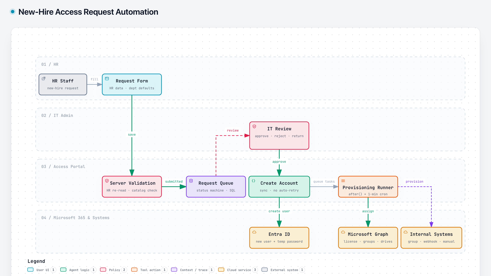

# New-Hire Access Request Automation

> Built for a multi-brand retail group's internal IT team. The source code is proprietary, so this page describes the design only.

## Problem

Onboarding a new hire meant HR filling in a form and IT reading it, then creating the account, assigning a license, adding mail groups, sharing drives and granting system access by hand, one step at a time. It was slow and easy to get wrong, and every new brand added more of it.

## Solution

HR submits one structured request. IT reviews it and approves, and the system does the rest.

1. **Request form:** HR picks the employee from the HR system. Department default rules pre-fill the usual mail groups and shared drives, and "same as this person" shortcuts copy someone else's access.
2. **Server validation:** on every save, the server re-reads the employee from the HR system, ignoring what the browser sent, and checks the email domain, the mail groups and the systems catalog.
3. **IT review:** IT can approve, reject or return the request (a reason is required to reject or return), and picks licenses from the tenant's live list.
4. **Create account:** on approval, the Entra ID user is created synchronously and a temporary password is generated. This step is never retried automatically.
5. **Provisioning runner:** the remaining steps run as ordered tasks through Microsoft Graph: license, then mail groups, then shared drives, then systems. Each system in the catalog says how it is provisioned: add to an Entra group, call a signed webhook, or leave a manual task for IT.
6. The requester gets the temporary password by email, and IT can see every step's status.

## Guardrails

- **Role-based decisions:** only IT admins can approve, and a status machine allows only valid transitions.
- **Optimistic locking:** every change carries a version, and a stale edit gets a 409 instead of overwriting.
- **Kill switch:** unless provisioning is enabled, every task is a dry run.
- **Secrets handled carefully:** temporary passwords are sealed with AES-256-GCM and cleared after 14 days. Revealing one is IT-only and logged, and passwords are scrubbed from error logs.
- **Signed webhooks:** HMAC-SHA256 signatures, https on the company domain only, and redirects are not followed.
- **Reliability:** idempotent task claims with locks, and retries at 1, 2, 5, 10 and 30 minutes. IT can retry a step or mark it done by hand.
- **Audit trail** for every action, including password views.

## Stack

Next.js · TypeScript · SQL Server · Microsoft Graph · Entra ID SSO · HR system data (read-only)
