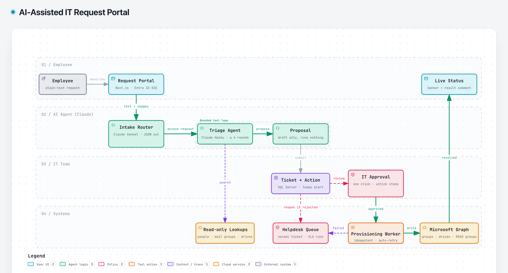

# AI-Assisted IT Request Portal

> Built for a multi-brand retail group's internal IT team. The source code is proprietary, so this page describes the design only.

## Problem

Every access request (mail groups, shared drives, new groups and folders) arrived as a free-form ticket. IT staff had to read each one, work out who and what it was for, look up the right group or drive, and make the change by hand. With new brands opening, the volume was about to grow faster than the team.

## Solution

Employees describe what they need in plain text (screenshots allowed). An AI pipeline turns that into a precise, ready-to-run action, and IT only has to approve it.

1. **Intake router (Claude Sonnet)** reads the request and returns structured JSON. It asks at most two clarifying questions, then routes to an access action, a normal ticket draft, a canned answer with a link, or the manual form.
2. **Triage agent (Claude Haiku)** runs a bounded tool loop (up to 4 rounds) with **read-only** lookups: the employee directory, the list of mail groups and the shared-drive catalog. It finishes with a single `propose` call that drafts the action and executes nothing.
3. **Ticket + pending action** are saved together and the helpdesk channel gets a Teams card.
4. **IT approval**: an admin reviews the draft and approves it in one click. They can untick individual person-item pairs first.
5. **Provisioning worker** applies the approved changes through Microsoft Graph: add to mail groups, share drive folders, create Microsoft 365 groups, create shared folders. It is idempotent and retries transient failures automatically.
6. The employee sees a **live status banner** on their ticket, and the ticket closes with a comment listing exactly what was granted.

## Guardrails

- **Human in the loop:** the AI can only propose. Every write needs IT approval, and no rule can be set to run without it.
- **Kill switch:** unless provisioning is switched on, every action ends as a dry run.
- **Directory validation:** targets must be enabled employee accounts (no guests), groups and drives must exist in known lists, reserved aliases are blocked, and batch sizes are capped.
- **Prompt-injection defence:** user text is wrapped and neutralised, and the model's output is checked against a schema.
- **Cost control:** a monthly budget and a per-user daily limit, with usage logged.
- **Safe fallbacks:** if the AI can't help, the user gets the normal ticket form prefilled with their text. A rejected or failed action reopens the ticket for a human, with the SLA still running.
- **Audit trail:** the proposed, confirmed and approved versions of every action are stored, along with the results.

## Stack

Next.js · TypeScript · SQL Server · Anthropic Claude (Sonnet + Haiku) · Microsoft Graph · Entra ID SSO · Microsoft Teams
