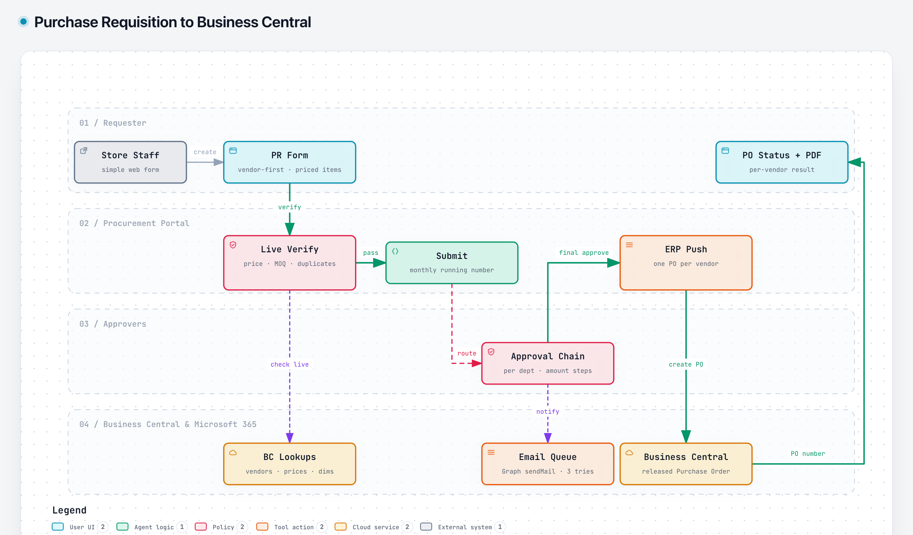

# Purchase Requisition to Business Central

> Built for a multi-brand retail group. The source code is proprietary, so this page describes the design only.

## Problem

Stores needed a simple way to request purchases. The requests had to follow department approval rules and end up as correct purchase orders in the ERP (Microsoft Dynamics 365 Business Central), with the right vendor prices, units and dimensions.

## Solution

A procurement portal that guides the requester, verifies everything against live ERP data, routes the request for approval and creates the purchase orders automatically.

1. **Vendor-first form:** the requester picks branch, delivery location and vendor. The item picker shows only items with a valid price agreement for that vendor, and dimensions are filled in automatically. Lines can be copied from a past order and are re-priced on import.
2. **Live verify:** before submitting, the request is checked against the ERP: items, units, vendor, dimensions, price against the agreement, minimum order quantity, duplicate open requests and number-series readiness. Errors block submission; warnings need an explicit acknowledgement.
3. **Submit:** a running number is assigned under a lock (per brand, resetting monthly).
4. **Approval chain:** steps are configured per sub-department, some with amount thresholds. Approvers can approve, reject, or return the request for another round. Notifications go out through an email queue.
5. **ERP push:** the final approval creates one released purchase order per vendor, and the requester can track each vendor's order and download the PDF.

## Guardrails

- **Approval integrity:** the approver can't be the requester, the live approver list is checked, and a stale approval step gets a 409.
- **Guarded status changes:** every transition is a conditional update, so concurrent edits can't overwrite each other.
- **No duplicate orders:** only failed vendors are re-sent, and the ERP refuses a second order for the same request and vendor.
- **Unknown outcomes reconciled:** if the ERP's answer is lost, the order is marked *unknown* and resolved by searching the ERP for the request number.
- **Safe attachments:** stored on SharePoint, type-checked by file content (including a macro check on workbooks), with size and count limits.
- **Multi-brand by design:** roles per brand, a separate ERP company per brand, and UAT and Production side by side.

## Stack

Next.js · TypeScript · SQL Server · Business Central OData · Microsoft Graph (mail, SharePoint) · Entra ID SSO
