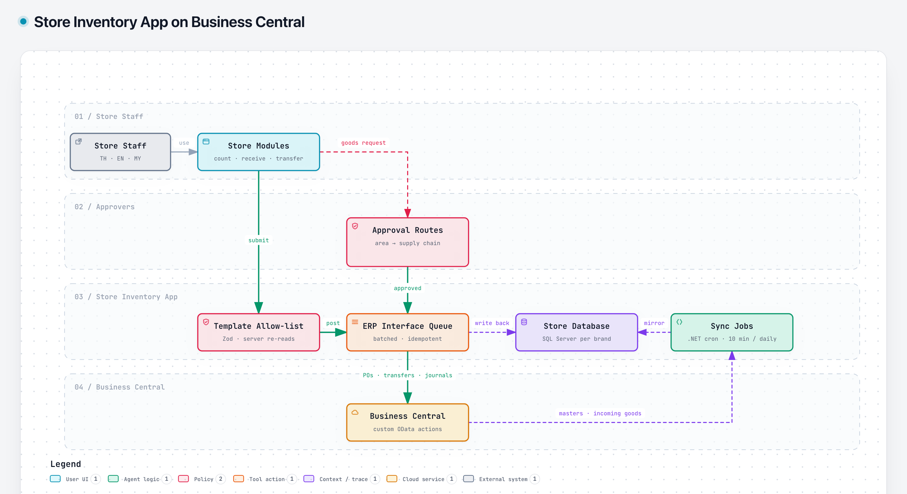

# Store Inventory App on Business Central

> Built for a multi-brand retail group. The source code is proprietary, so this page describes the design only.

## Problem

Store teams needed to count stock, receive deliveries, transfer goods, record wastage and order supplies, all of which have to land in the ERP (Microsoft Dynamics 365 Business Central). The ERP's own screens are built for back-office users, not for frontline staff working through a quick task on a store device.

## Solution

A web app built for store staff that writes to Business Central behind the scenes.

1. **Store modules:** stock count (daily, weekly or monthly templates), goods received (pending deliveries pulled live from the ERP), transfer out, wastage and damage, goods requests and production. The interface is in Thai, English and Malay.
2. **Template allow-list:** the server re-reads trusted fields from templates and validates every input, so the browser can't post items or quantities a store isn't allowed to.
3. **Approval routes:** goods requests go from area manager to supply chain, with extra steps for franchise stores. Late stock counts need a zone approver.
4. **ERP interface queue:** transactions are posted to custom Business Central OData actions in batches (purchase orders, transfer and sales orders, receipts, item journals, stock-count staging), and each line's status is written back.
5. **Sync jobs:** a .NET scheduled job mirrors master data daily and snapshots incoming goods every 10 minutes, so screens stay fast without hammering the ERP.

## Reliability

- **Duplicate-safe posting:** the ERP side returns the existing document for a repeated reference, and journal lines dedupe on an external document number.
- **Unknown outcomes are handled explicitly:** a lost or timed-out response marks the line *unknown*, and it is re-checked against the ERP before anything is resent.
- **Throughput limits respected:** batches of 200 to 500 lines, bounded concurrency, and long timeouts for heavy calls.
- **Audit:** per-line attempt history, run logs and approval override stamps.

## Multi-brand

One codebase runs as a separate deployment per brand and environment. Each has its own database, ERP company, document prefix and branding.

## Stack

Next.js · TypeScript · SQL Server · Business Central OData · .NET 8 scheduled jobs · Entra ID SSO · SharePoint (photo evidence)
